<h1 align="center">[ RED_TEAM // CHARANBS18 ]</h1>

  

  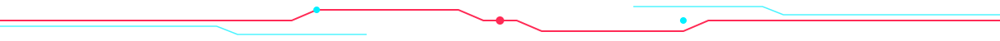

<!-- Section 1: Operator Profile -->

<h2 align="center">WHOAMI // OPERATOR PROFILE</h2>

<table align="center" border="0" cellpadding="15" cellspacing="0" style="border: 0px; border-collapse: collapse; margin: 0px auto; background-color: #0d1117;">
  <tr style="border: 0px;">
    <!-- Biometric HUD Frame with Operator Avatar -->
    <td align="center" valign="middle" style="border: 0px; padding: 10px; width: 40%;">
      

        
        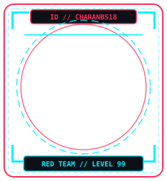
        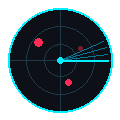
      

    </td>
    <!-- Operator Dossier Details -->
    <td valign="top" style="border: 0px; padding: 20px; width: 60%; font-family: monospace; color: #f8f9fa;">
      

        
      

      <h3 style="color: #ff2a55; margin-top: 0;">&gt; OPERATOR_ID.conf</h3>
      
<b>&gt; IDENTITY:</b> Charan BS / @CharanBS18

      
<b>&gt; CLEARANCE:</b> <code style="color: #00f0ff;">Ethical Hacker | Pentester | Bug Bounty | CTF Player</code>

      
<b>&gt; PLATFORM:</b> <a href="https://tryhackme.com/" style="color: #ff2a55;">TryHackMe</a> &bull; Kali Linux

      
<b>&gt; COMMS_PORT:</b> <a href="mailto:charan201204@gmail.com" style="color: #00f0ff;">charan201204@gmail.com</a>

      

      

        Offensive security researcher focused on web application penetration testing, bug bounty hunting, network reconnaissance, and Capture The Flag (CTF) challenges. Breaking systems ethically to understand attack surfaces and engineer stronger defenses.
      

    </td>
  </tr>
</table>

  

<!-- Section 2: Offensive Arsenal -->

<h2 align="center">OFFENSIVE ARSENAL &amp; TOOLKIT</h2>

  
  
  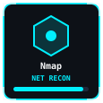
  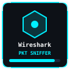
  
  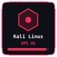
  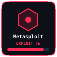
  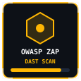
  

<table align="center" border="0" cellpadding="8" cellspacing="0" style="border: 0px; border-collapse: collapse; margin: 10px auto;">
  <tr style="border: 0px;">
    <td style="border: 0px;">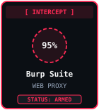</td>
    <td style="border: 0px;">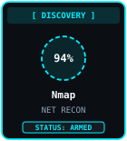</td>
    <td style="border: 0px;">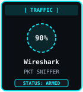</td>
    <td style="border: 0px;">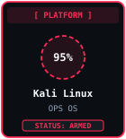</td>
    <td style="border: 0px;">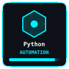</td>
    <td style="border: 0px;">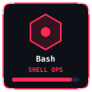</td>
  </tr>
</table>

  

<!-- Section 3: Active Recon Console -->

<h2 align="center">ACTIVE RECON CONSOLE</h2>

<table align="center" border="0" cellpadding="15" cellspacing="0" style="border: 0px; border-collapse: collapse; margin: 0px auto; background-color: #0d1117;">
  <tr style="border: 0px;">
    <td align="center" valign="middle" style="border: 0px; padding: 10px; width: 46%;">
      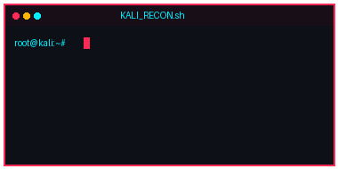
    </td>
    <td valign="top" style="border: 0px; padding: 20px; width: 54%; font-family: monospace; color: #f8f9fa; line-height: 1.65;">
      

        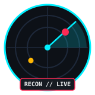
      

      <h3 style="color: #00f0ff; margin-top: 0;">&gt; ACTIVE_ENGAGEMENT.log</h3>
      
<b>&gt; STATUS:</b> Enumerating web attack surfaces &amp; CTF labs

      
<b>&gt; OBJECTIVE:</b> OWASP Top 10 auditing, automated recon &amp; exploit analysis

      
<b>&gt; STACK:</b> <code>Burp Suite</code> <code>Nmap</code> <code>Wireshark</code> <code>Metasploit</code> <code>OWASP ZAP</code>

      

        
        [ LIVE TELEMETRY // TRYHACKME &amp; BUG BOUNTY GRIND ]
      

    </td>
  </tr>
</table>

  

<!-- Section 4: Operations Dossier -->

<h2 align="center">OPERATIONS DOSSIER &amp; LAB TRACKS</h2>

<table align="center" border="0" cellpadding="10" cellspacing="0" style="border: 0px; border-collapse: collapse; margin: 0px auto; width: 100%; max-width: 960px;">
  <tr style="border: 0px;">
    <td valign="top" style="border: 0px; width: 33%; padding: 8px; text-align: center;">
      <a href="https://github.com/CharanBS18?tab=repositories">
        
      </a>
    </td>
    <td valign="top" style="border: 0px; width: 33%; padding: 8px; text-align: center;">
      <a href="https://github.com/CharanBS18?tab=repositories">
        
      </a>
    </td>
    <td valign="top" style="border: 0px; width: 33%; padding: 8px; text-align: center;">
      <a href="https://github.com/CharanBS18?tab=repositories">
        
      </a>
    </td>
  </tr>
</table>

  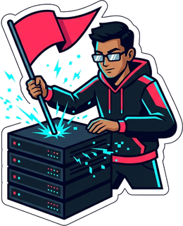

  

<!-- Section 5: TryHackMe & Security Medallions -->

<h2 align="center">SECURITY CLEARANCE &amp; MEDALLIONS</h2>

  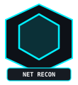
  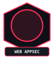
  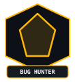
  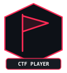
  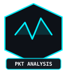
  

  

<!-- Section 6: Telemetry & Contribution Matrix -->

<h2 align="center">TELEMETRY &amp; PACKET TRACE</h2>

<table align="center" border="0" cellpadding="10" cellspacing="0" style="border: 0px; border-collapse: collapse; margin: 0px auto;">
  <tr style="border: 0px;">
    <td align="center" valign="middle" style="border: 0px; padding: 10px;">
      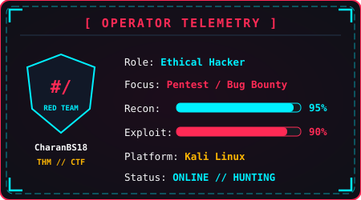
    </td>
    <td align="center" valign="middle" style="border: 0px; padding: 10px;">
      
    </td>
  </tr>
</table>

  

<!-- Packet Trace Contribution Snake -->

  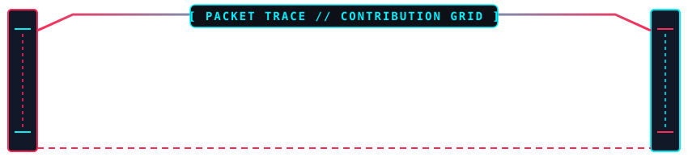

  <picture>
    <source media="(prefers-color-scheme: dark)" srcset="https://raw.githubusercontent.com/CharanBS18/CharanBS18/output/github-contribution-grid-snake.svg?v=3">
    <source media="(prefers-color-scheme: light)" srcset="https://raw.githubusercontent.com/CharanBS18/CharanBS18/output/github-contribution-grid-snake-light.svg?v=3">
    
  </picture>

  

<!-- Section 7: Encrypted Comms -->

<h2 align="center">ENCRYPTED COMMS // DISPATCH</h2>

  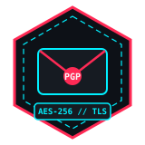
  <a href="mailto:charan201204@gmail.com" style="display: inline-block; background-color: #161b22; color: #00f0ff; border: 2px solid #ff2a55; padding: 14px 28px; border-radius: 6px; text-decoration: none; font-weight: bold; font-family: monospace;">
    TRANSMIT ENCRYPTED PACKET
  </a>
  <a href="https://tryhackme.com/" style="display: inline-block; background-color: #161b22; color: #ff2a55; border: 2px solid #00f0ff; padding: 14px 24px; border-radius: 6px; text-decoration: none; font-weight: bold; font-family: monospace;">
    TRYHACKME PROFILE
  </a>

<!-- Red Team Footer -->

  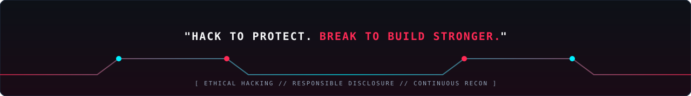

  NODE TELEMETRY:  // SESSION ENCRYPTED // RED TEAM OPS

